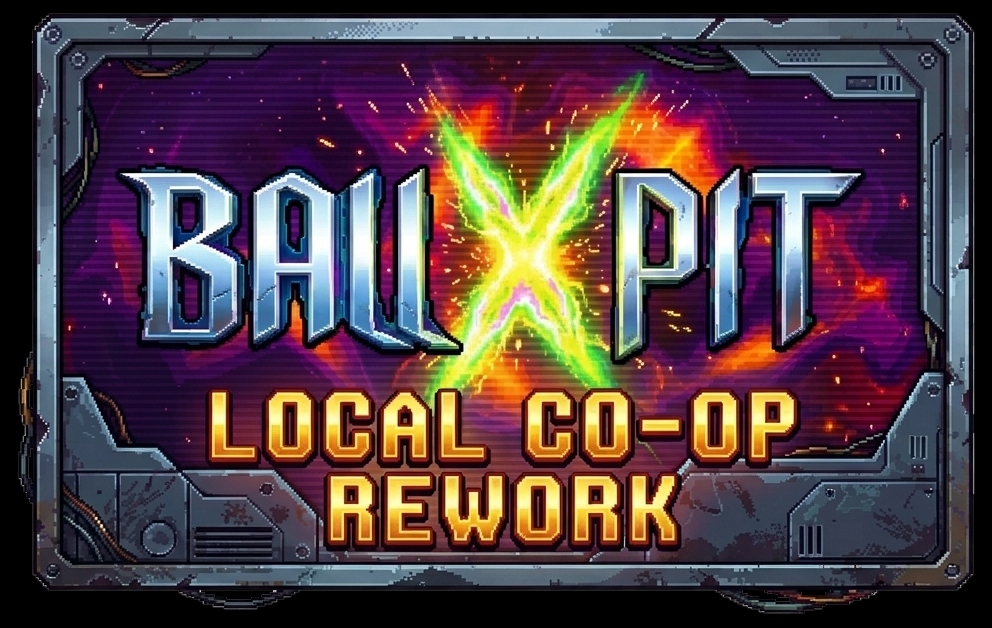

<p align="center">
  
</p>

<h1 align="center">BALL x PIT — Local Co-op Rework (v1.0)</h1>

<p align="center">
  <b>A complete, unified 2-Player Local Co-op overhaul for <i>BALL x PIT</i> with full Town &amp; Meta Progression and seamless Solo + Co-op support.</b>
</p>

<p align="center">
  
  
  
  
</p>

---

## ✨ What Is Local Co-op Rework?

**BALL x PIT: Local Co-op Rework** is a ground-up, single-DLL rewrite (`BALLxPITLocalCoop.dll`) that turns *BALL x PIT* into a true **Solo & 2-Player Local Co-op** experience without stripping away the core game loop.

Unlike standalone arcade-only co-op modes that bypass the Town or require multiple separate plugins, **Local Co-op Rework v1.0** integrates directly into your existing save and **Town (Base)**—so every Co-op run benefits from your Town buildings and feeds right back into your permanent progression, Harvests, Blueprints, and Unlocks.

---

## 🎮 Key Features

### 🏰 Seamless Solo & Co-op Play with Full Progression
- **Switch Freely in Town:** Launch **SOLO** or **CO-OP** directly from the Town Play button at any time.
- **Full Town & Meta Progression:** Co-op runs apply all your Town building bonuses (starter ball/passive levels, revives, stat upgrades, housing bonuses) and award **full post-run progression**—including **Harvests, Gold, Resources, Blueprints, Gears, Trophies, and Stage/Character Unlocks**.
- **Endless Mode & Quick Rematch:** Continue victorious Co-op runs into **Endless Mode** or jump straight into a **Quick Rematch**.

### ⚔️ True Independent 2-Player Gameplay
- **Independent Characters & Stats:** Player 1 and Player 2 each choose their own Character (with full support for unlocked base and DLC characters), maintain their own movement/firing/reload stats, and control their own aim and special abilities.
- **Separate Ball & Passive Inventories:** Each player manages their own Ball lineup, Baby Ball followers, and Passive items with dedicated ammo and cooldown tracking.
- **Side-by-Side Level-Up & Fuser Menus:** When leveling up or collecting a Fuser, both players make their own choices simultaneously on a split decision overlay—supporting **New Balls, Passives, Evolutions, Pair Fusions, Fission, Rerolls, and Banishes**.

### ❤️ Team Vitals, Field Rescue & Revives
- **Individual Health Pools:** Each player has their own HP bar and status tracking.
- **On-Field Partner Rescue:** When one player is downed, a glowing **Rescue Ring** appears around them—stand inside the ring to revive your partner mid-battle!
- **Shared Team Revives:** If both players go down, use your team's earned Revives to get back into the fight together.

### 🎮 Flexible Input & Controller Routing
- **Play Your Way:**
  - **2 Gamepads** (Xbox / PlayStation / Rewired-compatible controllers)
  - **1 Gamepad + Keyboard & Mouse**
  - **Shared Keyboard** (both players on one keyboard, with TKL/compact keyboard fallbacks)
- **Smart Hot-Plug & Disconnect Guard:** Automatically pauses the battle and notifies you if a controller disconnects mid-run.

### 📊 Co-op HUD, Visual Clarity & Balance
- **Dedicated Player HUDs:** Individual P1 & P2 HUD cards showing health, active balls, passives, and live **DPS**.
- **Color-Coded Clarity:** Distinct player ground rings, aim cursors, and ball ownership tracking so you never lose track of your character in bullet-heavy arenas.
- **Post-Round Co-op Breakdown:** End-of-run results screen comparing P1 and P2 damage, kills, DPS, and ball performance.
- **Configurable Co-op Balance:** Optional enemy and boss damage-resistance scaling to keep 2-player firepower balanced (customizable in the Pause menu or config file).
- **Bilingual Support:** Full English and French UI localization.

---

## ⚙️ How It Works

```
Town (Base) ──► Choose [SOLO] or [CO-OP]
                   │
                   ├─► [SOLO]: Vanilla single-player run (100% untouched)
                   │
                   └─► [CO-OP]:
                         1. Both players select their Character & Stage
                         2. Enter the Pit with independent inventories, stats & HUDs
                         3. Level up, Fuse, Evolve & Rescue each other in real time
                         4. Return to Town with all Rewards, Unlocks & Harvest ready!
```

---

## 📦 Easy Installation

> [!IMPORTANT]
> **Prerequisite:** You must have **BepInEx 6 (Unity IL2CPP x64)** installed in your `BALLxPIT` game folder.
> If you previously used an older version of Local Co-op, **delete** any old `CoopBalance.dll`, `TwoGamepads.dll`, or duplicate `BALLxPITLocalCoop.dll` files from `BepInEx/plugins/` before installing—**v1.0 combines everything into a single DLL!**

1. Download **`BALLxPIT-Local-Coop-Rework-v1.0.zip`** from the [**Releases**](../../releases) page.
2. Open your *BALL x PIT* installation folder (where `Balls.exe` is located, e.g. `Steam\steamapps\common\BALLxPIT`).
3. Extract the `.zip` directly into the game folder. The archive already contains the required folder structure:
   ```text
   BALLxPIT/
   └── BepInEx/
       └── plugins/
           └── BALLxPITLocalCoop.dll
   ```
4. Launch *BALL x PIT*, enter your Town, and click the **CO-OP** button next to **SOLO** (or press **Tab** / **Left Stick Click**)!

---

## ⚠️ Possible Issues & Troubleshooting

- **Conflict with Older Co-op Plugins (`CoopBalance.dll` / `TwoGamepads.dll`):**
  - *Symptom:* Double menus, broken controller routing, or duplicate health bars.
  - *Fix:* Make sure **only** `BALLxPITLocalCoop.dll` is inside `BepInEx/plugins/`. Remove any legacy folders like `BepInEx/plugins/LocalCoopBalance/`, `BepInEx/plugins/LocalCoopTwoGamepads/`, or `BepInEx/plugins/BALLxPITLocalCoop/`.
- **First Launch Takes 15–30 Seconds Longer:**
  - *Symptom:* Brief black screen or pause before the splash screen on first boot after installing BepInEx.
  - *Fix:* This is normal—BepInEx IL2CPP generates interop assemblies on the first launch. Subsequent launches are fast.
- **Controller Inputs Controlling Both Players (Steam Input):**
  - *Symptom:* One controller moves both P1 and P2, or a controller isn't detected in slot 2.
  - *Fix:* Open the in-game **Co-op Pause Menu -> Co-op Settings** to cycle Input Mode (`Auto`, `2 Gamepads`, `KB+M + Gamepad`, `Gamepad + KB+M`, or `Shared Keyboard`), or disable Steam Input desktop-Mouse emulation if Steam is converting your controller into keyboard keys.
- **Customizing Player 2 Keyboard Controls or Co-op Balance:**
  - All keybindings, player colors, and enemy/boss resistance multipliers can be adjusted in `BepInEx/config/hyrule.ballxpit.localcoop.cfg` or live via the in-game **Co-op Pause Menu**.
- **Game Updates:**
  - Because *BALL x PIT* is a Unity IL2CPP title, major game patches that alter internal `BallMgr` or `UpgradeMgr` signatures may require a mod update.

---

## 🛠️ Open Source, Building & Forking

This repository includes the full unpacked C# source code of **BALL x PIT: Local Co-op Rework** for open-source transparency, community contributions, and forking.

### Repository Layout
```text
├── BALLxPITLocalCoop.csproj      # .NET 6 IL2CPP plugin project
├── assets/
│   └── logo.jpg                  # Project header logo
└── src/
    ├── Core/                     # Plugin entry point, config, localization, session & mode state
    ├── Diagnostics/              # Optional native stall/hang watchdog
    ├── Gameplay/                 # Character runtime, combat, vitals, ammo recovery, pickups & balance
    ├── Input/                    # Multi-controller & keyboard/mouse routing + aim rules
    ├── PlayerTwo/                # Native P2 clone lifecycle, BallMgr virtualization & inventory isolation
    └── UI/                       # Town Co-op button, Character/Stage select, Level-Up/Fuser overlay, HUD & Results
```

### Building from Source
1. Install the [.NET 6.0 SDK](https://dotnet.microsoft.com/download/dotnet/6.0).
2. Ensure *BALL x PIT* with BepInEx 6 IL2CPP has been launched at least once so `BepInEx/interop/` assemblies exist.
3. Build the project, pointing `GameDir` to your *BALL x PIT* installation path:
   ```powershell
   dotnet build BALLxPITLocalCoop.csproj -c Release -p:GameDir="C:\Path\To\BALLxPIT"
   ```
   The compiled `BALLxPITLocalCoop.dll` will be output to `bin/Release/net6.0/` and automatically copied to `$(GameDir)\BepInEx\plugins\`.

---

## 🏆 Credits & Acknowledgements

- **Hyrule (`HyruleChosenOne`)** — Creator & Lead Developer of **BALL x PIT: Local Co-op Rework (v1.0)**:
  - Complete clean-slate single-DLL architecture rewrite, full Town & Solo/Co-op meta-progression integration, dual-player `BallMgr` & `UpgradeMgr` virtualization, simultaneous Level-Up/Fuser decision engine, flexible input routing, and physics/ammo-recovery fixes.
- **sparrowsj** — Creator of the original [*BALLxPIT Local Coop*](https://www.nexusmods.com/ballxpit/mods/24) (`v0.1.0` / `v0.1.4`) base mod that pioneered native Player 2 cloning in *BALL x PIT*.
- **Extermineg (Adeck Games)** — Creator of the *BALL x PIT Local Co-op Companion* (`v2.1.x`), whose co-op HUD, revival, and companion systems inspired and informed this rework.
- **Kenny Sun & Friends / Devolver Digital** — Developers and publisher of ***BALL x PIT***. Please support the official game and its DLCs!
- **BepInEx, HarmonyX, Il2CppInterop & MonoMod Contributors** — For the Unity IL2CPP modding framework and runtime patching infrastructure.

